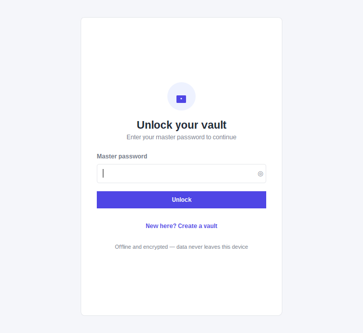
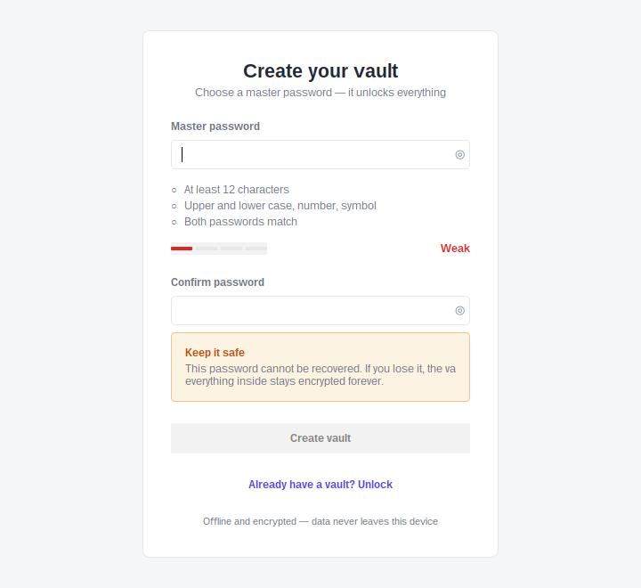
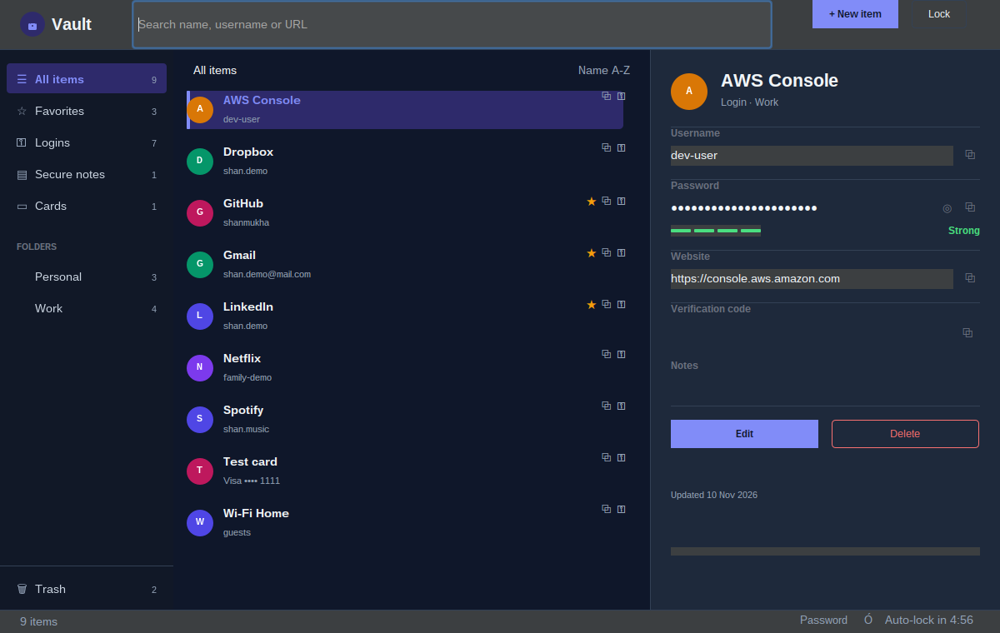
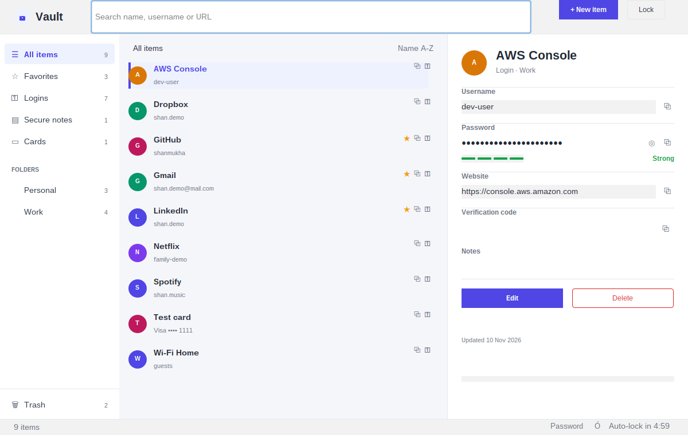
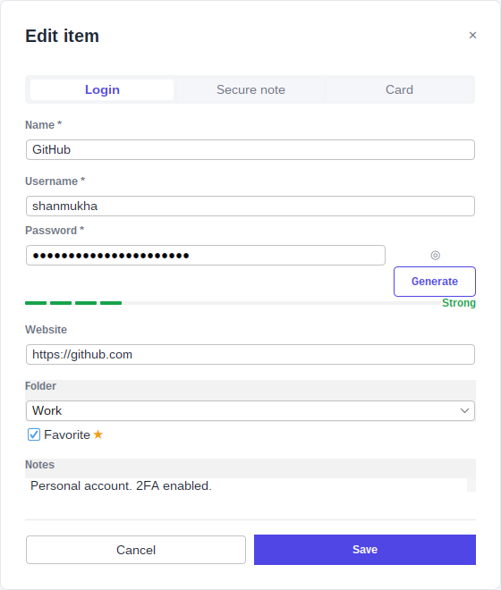

# Secure Vault

An offline, encrypted password vault for a single user, built in Java 21 +
Swing. Labels, usernames, passwords, notes and TOTP seeds live in **one
encrypted file** (`vault.dat`); nothing is ever written to disk in plaintext
and nothing ever leaves the machine. Educational project — see
[`docs/LIMITATIONS.md`](docs/LIMITATIONS.md) before storing anything you
actually care about.

[](https://github.com/shanmukha-3283/secure-vault/actions/workflows/ci.yml)

## Screenshots

| Unlock | Create vault |
|---|---|
|  |  |

| Main window (dark) | Main window (light) |
|---|---|
|  |  |

| Add / edit item |
|---|
|  |

## Features

**Core**
- Add, edit, search and delete entries (login / secure note / card)
- Master-password authentication, PBKDF2 key derivation
- Vault file is encrypted end-to-end; deletes are soft (Trash view)
- Every input is validated centrally in `util/Validator`

**Security & hardening**
- `PBKDF2WithHmacSHA256`, 600,000 iterations, 16-byte salt, 256-bit key
- `AES/GCM/NoPadding` with a fresh 12-byte IV on every save; header (magic +
  version + salt + IV) bound into the GCM AAD
- Atomic saves: `vault.dat.tmp` → `Files.move(…, ATOMIC_MOVE)`
- Wrong-password attempt backoff that grows exponentially (never a permanent
  lock)
- Auto-lock after 5 idle minutes; clipboard clears automatically after 20 s
- Change master password re-encrypts the whole vault with a new salt + IV
- Password generator + strength meter; create/rotate dialogs block weak
  choices inline
- TOTP verification codes per entry (real RFC 6238, live countdown ring)
- Light/dark theme toggle remembered between runs

**Values on disk** ([`docs/THREAT_MODEL.md`](docs/THREAT_MODEL.md) details what
this defends): the file never contains the master password or any plaintext.

## Build & run

Requirements: JDK 21 and Maven 3.9+.

```bash
# Tests (JUnit 5 + AssertJ; headless-safe)
mvn -q verify

# Run the app (writes vault.dat next to your current directory)
mvn exec:java
```

## Project layout

```
src/main/java/com/shanmukha/vault/
  App.java                 # FlatLaf setup, theme persistence, window handover
  model/                   # Entry, VaultData (records)
  crypto/                  # KeyDeriver, CryptoService, generator, strength, TOTP
  storage/                 # VaultRepository (atomic encrypted file I/O)
  service/                 # VaultService (auth + CRUD + search business logic)
  ui/                      # Swing windows, dialogs, painted components
  util/                    # Validator, ClipboardCleaner
src/test/java/…            # 94 unit tests + UiCapture (test-scope screenshot tool)
docs/                      # LIMITATIONS.md, THREAT_MODEL.md, ui/ mockups, screenshots/
```

Layering rule enforced by convention: `ui/` calls `service/` only; crypto and
file access never appear inside UI classes.

## Screenshots tooling

`src/test/java/com/shanmukha/vault/ui/UiCapture` rebuilds
`docs/screenshots/*.png` from the real Swing components with throwaway fake
data under the system temp directory. See the class header for the exact
commands.

## Status & roadmap

- [x] Phases 1–7: crypto core, storage, service, validation, GUI, hardening
- [x] Master password rotation (re-encryption with fresh salt + IV)
- [x] CI (GitHub Actions, JDK 21)
- [ ] Packaging: shaded jar or `jpackage` + GitHub release

---
Educational project. Not audited. Provided as-is without any warranty.
